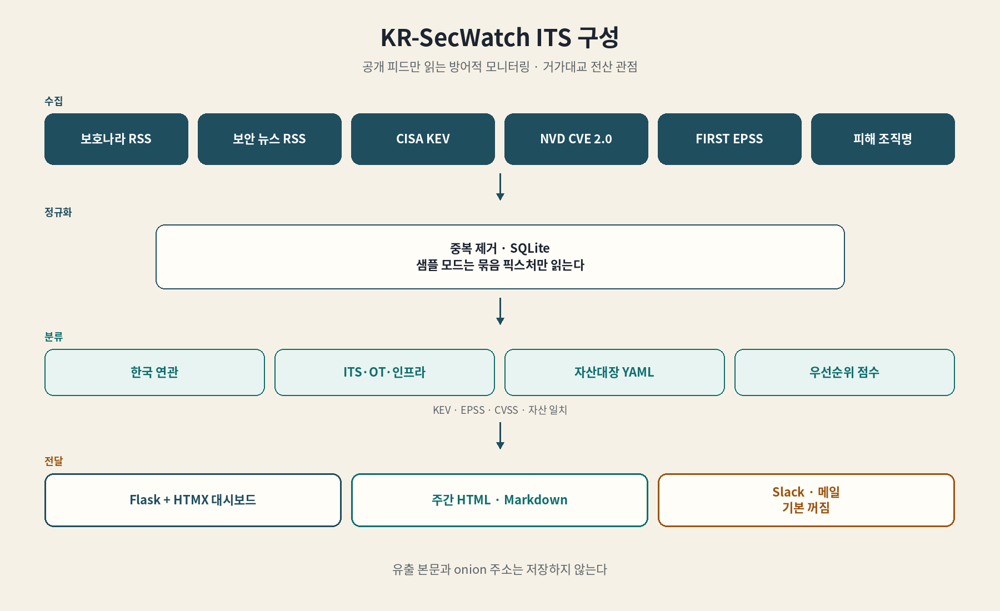
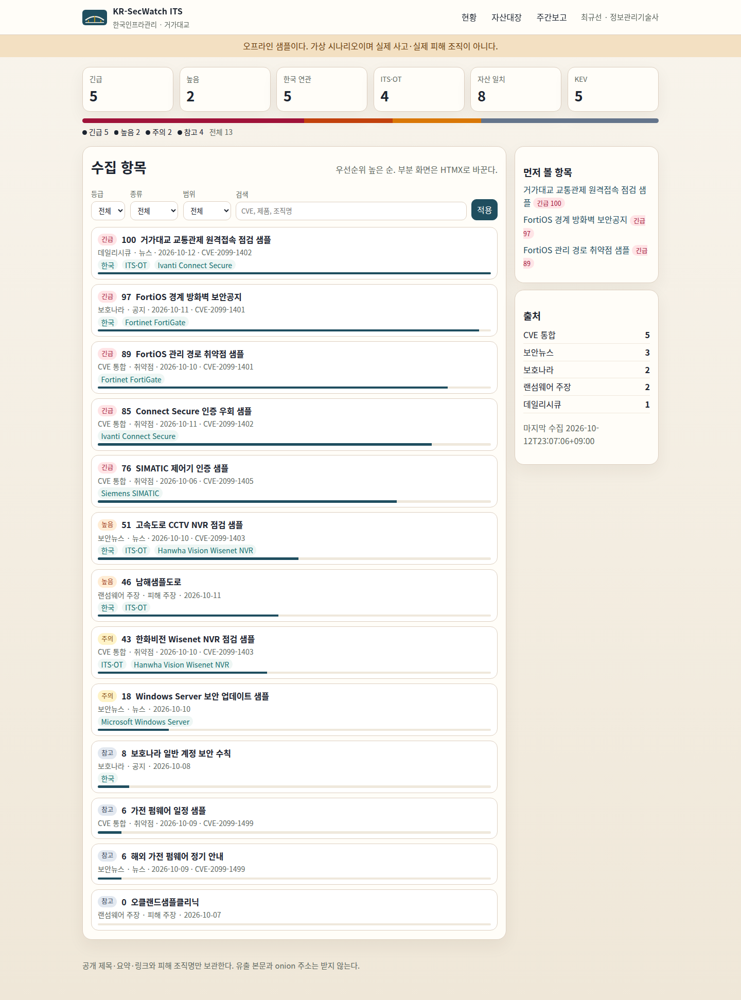
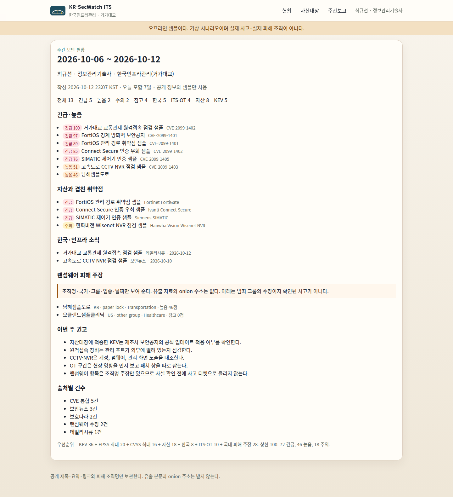
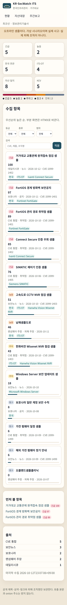

# KR-SecWatch ITS

거가대교 전산 관점의 공개 위협 모니터. 보호나라 공지, 보안 뉴스, CISA KEV, NVD, EPSS, 랜섬웨어 피해 조직명을 모아 한국 연관과 ITS·OT 여부를 매기고, 자산대장과 겹치면 우선순위를 올린다.

- 운영 관점: 최규선, 정보관리기술사, 한국인프라관리(거가대교) 전산시스템 총괄
- 관심 범위: ITS·교통, 도로·교량, OT/SCADA/ICS, CCTV/NVR, Fortinet·Cisco·Ivanti, Windows/Linux 서버
- 동작 원칙: 공개 RSS·API만 읽고, 공격 절차는 다루지 않으며, 알림은 기본 꺼짐
- 실행: Python 3.11+, Flask, HTMX, SQLite. 네트워크 없이 샘플로 바로 뜬다



## 1. 기능

- 수집
  - 보호나라 보안공지·취약점 RSS
  - 보안뉴스, 데일리시큐 RSS (제목·짧은 요약·링크)
  - CISA KEV JSON
  - NVD CVE API 2.0 (CVSS)
  - FIRST EPSS API (악용 확률)
  - ransomware.live 공개 API의 한국 피해 조직명. 국가·그룹·업종·날짜만 남긴다
- 분류
  - 한국 연관: 지명, 기관, `.kr`, 국가 코드 KR
  - ITS·OT 태그: 교통, 교량, 요금, 전광, CCTV, SCADA/PLC, 기반시설, 업종
  - 자산대장: `secwatch/assets/inventory.yaml` 별칭 일치
- 우선순위 (상한 100)
  - KEV 36
  - EPSS 확률 × 20, 최대 20
  - CVSS ÷ 10 × 16, 최대 16
  - 자산 일치 18 (여러 개여도 1회)
  - 한국 연관 8
  - ITS·OT 10
  - 국내 피해 주장 28
  - 72 이상 긴급, 46 이상 높음, 18 이상 주의, 그 외 참고
- 저장: SQLite. 출처와 외부 키가 같으면 갱신
- 알림: Slack webhook 또는 SMTP. 환경 변수가 없으면 전송하지 않는다. 샘플 모드도 전송하지 않는다
- 보고: 오늘 포함 7일 HTML·Markdown
- 화면: 현황, 자산대장, 주간보고. 필터는 HTMX. 좁은 화면은 한 열로 접힌다

## 2. 화면







## 3. 실행

```bash
python3 -m venv .venv
. .venv/bin/activate
pip install -e ".[dev]"
python -m secwatch serve --demo
```

- 현황: http://127.0.0.1:8080
- 샘플 배너가 보이면 가상 데이터다. 실제 사고가 아니다
- 수집만: `python -m secwatch collect --demo`
- 주간 보고: `python -m secwatch report --demo --out reports`
- 검사: `pytest`
- 라이브 수집: `python -m secwatch collect` (기본 바인딩은 `127.0.0.1`)

Docker

```bash
docker build -t kr-secwatch-its .
docker run --rm -p 8080:8080 kr-secwatch-its
```

- 이미지는 샘플 모드로 8080을 연다
- 한글 표시를 위해 Noto CJK를 넣는다

## 4. 설정

값은 환경 변수 또는 작업 디렉터리 `.env`. 예시는 `.env.example`.

- `SECWATCH_DEMO`: `1`이면 샘플
- `SECWATCH_DB`: SQLite 경로. 샘플 기본 `data/demo.db`
- `SECWATCH_INVENTORY`: 자산대장 YAML
- `SECWATCH_MIN_PRIORITY`: 알림 하한. 기본 46 (높음)
- `SECWATCH_NVD_MAX`: 한 번에 보강할 CVE 수. 기본 15
- `NVD_API_KEY`: 없으면 조회 사이에 간격을 둔다
- `SLACK_WEBHOOK_URL`: 비우면 Slack 꺼짐. 호스트는 `hooks.slack.com`만 허용
- `SMTP_HOST`, `ALERT_EMAIL_FROM`, `ALERT_EMAIL_TO`: 셋이 있어야 메일
- `SMTP_PORT`, `SMTP_USER`, `SMTP_PASSWORD`, `SMTP_TLS`

알림 조건

- 점수가 하한 이상
- 한국 연관, ITS·OT, 자산 일치 중 하나
- 같은 항목·채널은 한 번만 전송
- 한 실행에 최대 10건

수집 범위

- KEV는 자산·한국·ITS에 해당하는 것과, 이번 수집 기사에 나온 CVE만 남긴다
- 뉴스·공지는 피드당 최신 40건
- 랜섬웨어는 `/v2/countryvictims/KR` 한 번. 분당 호출 제한이 있다
- 기사 본문 전문, 유출 목록, onion 주소, `claim_url`은 저장하지 않는다
- 피해 등록은 범죄 그룹의 주장이다

## 5. 구조

```
secwatch/
  cli.py            collect | serve | report
  classify.py       연관 규칙과 점수
  assets/inventory.yaml
  collect/          RSS, KEV, NVD, EPSS, ransomware.live
  fixtures/         오프라인 샘플
  store.py          SQLite
  alerts.py         Slack, 메일
  report.py         주간 보고
  web/              Flask + HTMX
docs/images/        구성도, 화면 캡처
```

- 구성도 다시 그리기: `python tools/render_architecture.py` (Noto Sans CJK KR, Pillow)
- 화면 다시 찍기: `python tools/capture_screenshots.py` (Playwright, Chromium)

## 6. 데이터

- 뉴스·공지: 제목, 짧은 요약, 원문 링크. 저작권은 각 매체에 있다
- CVE: 식별자, 점수, 짧은 설명, NVD 링크
- 피해 주장: 조직명, 국가, 그룹, 업종, 날짜. 상세는 ransomware.live 첫 화면만 연결
- 샘플 픽스처의 CVE 번호와 조직명은 가상이다

## 7. 출처 및 참고

- 아이디어: [ngnicky-ai/kr-secwatch](https://github.com/ngnicky-ai/kr-secwatch). 한국 보안 위협을 한 화면에서 보고 Slack으로 알리는 구상에서 출발했다
- 그 저장소는 라이선스가 없다. 코드, 템플릿, 키워드 목록, 화면 자산은 가져오지 않았다
- 이 저장소는 거가대교 ITS·OT 자산 관점으로 새로 작성한 독립 구현이다
- 수집 주소
  - 보호나라 RSS `https://www.boho.or.kr/kr/rss.do?bbsId=B0000133`, `B0000302`
  - 보안뉴스 `https://cdn.boannews.com/rss/gn_rss_allArticle.xml`
  - 데일리시큐 `https://www.dailysecu.com/rss/allArticle.xml`
  - CISA KEV `https://www.cisa.gov/sites/default/files/feeds/known_exploited_vulnerabilities.json`
  - NVD CVE API 2.0 `https://services.nvd.nist.gov/rest/json/cves/2.0`
  - FIRST EPSS `https://api.first.org/data/v1/epss`
  - ransomware.live `https://api.ransomware.live/v2/countryvictims/KR`
- 화면 보조: htmx 2.0.4 (0BSD). 고지 `secwatch/web/static/htmx.LICENSE.txt`
- 라이선스: MIT. Copyright 2026 최규선 (kh20134)
